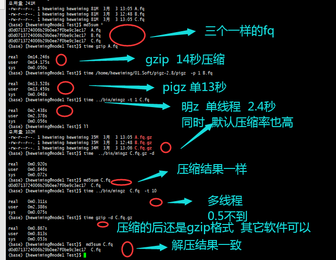

# mingz
<b>mingz: An ultra-fast gzip file tools</b>
<br>mingz: An ultra-fast gzip file tool that supports multithreading, etc., is faster than both pigz and gzip in comprehensive testing
##  1. Install
### (1) Building from source （Linux or Mac）
```
git clone https://github.com/hewm2008/MingZ.git
cd MingZ
make
cd bin
./mingz -h
```
## 2. Usage
```
	Usage: mingz  big1.fq *.fq
	Options:
		-i   <str>   input of text file or pipe
		-o   <str>   output of text file
		-t   <int>   number of threads [8]
		-l   <int>   compression level 1-12 [9]
		-b   <int>   block size in MB [2]
		-c           write on standard output
		-d           decompress(no threads)
		-h           show help hewm2008[v1.14]
```
## 3. Example
### 3.1 
```
	mingz  InA.fq  InB.fq  -o NewOutA.fq.gz   -o NewOutB.fq.gz 
	mingz *.fq   # will remove raw file out InA.fq.gz InB.fq.gz
	mingz  InA.fq  -t  10  # muti threads
	mingz  InA.fq  -t 64 -l 9        # threads + compression level (1-12)
	mingz  InA.fq  -t 64 -l 12 -b 4  # highest ratio, 4 MB blocks
	cat  InA.fq  | mingz  > NewOutA.fq.gz  ##    cat  InA.fq  | mingz  -o  NewOutA.fq.gz
```
### 3.2 decompress File
```
	mingz In.fq.gz -c -d  > new.Fq
	mingz -i In.Fa.gz -o  OutNew.fq  
	mingz *.gz -d   # will remove raw file
```
## 4. accuracy and efficiency
An ultra-fast tool: mingz > pigz > gzip.

### 4.1 Benchmark (v1.14)
Test environment: 80-core Linux server, single 3.0 GB FASTQ file (3,024,000,000 bytes).
Tools: gzip 1.12 (single-thread), pigz 2.8, mingz 1.13 / 1.14.
All decompressed outputs were verified with `md5sum` (every result matches the original, lossless).

**Compression** (ratio = original / compressed, default = `-l 9 -b 2`):

| tool            | threads | level | block | wall   | CPU%  | per-core eff | size (bytes)  | ratio |
|-----------------|:-------:|:-----:|:-----:|:------:|:-----:|:------------:|:-------------:|:-----:|
| gzip            |    1    |   6   |   -   | 431.99s| 99%   | 99%          | 599,265,143   | 5.046 |
| pigz 2.8        |   64    |   6   |   -   | 9.82s  | 5466% | 85%          | 599,926,558   | 5.041 |
| pigz 2.8        |   64    |   9   |   -   | 20.95s | 5386% | 84%          | 577,840,569   | 5.233 |
| **mingz 1.14**  |   32    | **9** | **2MB** | **7.16s** | 3045% | **95%**  | 577,112,293   | **5.240** |
| **mingz 1.14**  |   64    | **9** | **2MB** | **4.47s** | 5417% | 85%      | 577,112,293   | **5.240** |

- The default level is 9 and block size 2MB. At t32 the per-core efficiency reaches 95%; at t64 wall time is just 4.47s.
- vs pigz: ~4.7x faster at default settings, with a better ratio (5.240 vs 5.041).
- vs gzip: ~98x faster.
- Block size 2MB improves ratio by +0.13% over 1MB with no measurable speed penalty.

**Decompression** (3.0 GB, single-thread; mingz output is standard multi-member gzip):

| tool            | wall   | note |
|-----------------|:------:|------|
| **mingz 1.14 -d** | **3.0s** | libdeflate + mmap, lossless |
| pigz 2.8 -d     | 9.47s  | |
| gzip / gunzip   | 20.00s | |
| mingz 1.12 -d   | 23.94s | slow, and **lossy** for files with blank lines / no trailing newline |

mingz decompression is ~3x faster than pigz -d and ~6.5x faster than gunzip.
It stays fully compatible with standard gzip in both directions (mingz <-> pigz <-> gunzip, all md5 verified).

### 4.2 What's new in v1.14
- **Default block size changed from 1 MB to 2 MB** (`-b 2`): compression ratio improves by +0.13% at no measurable speed penalty.
- **Fixed empty input**: produces a valid 23-byte gzip member for empty files (was 0 bytes).
- **Fixed stdin decompression without `-c`**: `/dev/stdin -d` now correctly outputs to stdout instead of writing to `/dev/std`.
- **Deeper pipeline buffer**: block pool increased from `nThreads×2+2` to `nThreads×4+2` for better read/compress overlap at high thread counts.
- **Cleaner decompression output path**: replaced `add_Asuffix`+`substr(0,len-3)` chain with direct `.gz` suffix removal.
- **Reduced memory over-allocation on decompression**: buffer growth factor reduced from 4× to 2× (`outCap *= 2`) for large single-member gzip files.
- **Code cleanup**: `sync_with_stdio(false)` / `cin.tie(0)` moved from 4 functions to `main()`; `replace_all` simplified to direct `erase()`.
- **Updated defaults**: `-l 9 -b 2` (was `-l 9 -b 1`).


## 5. License
------------
  This project is licensed under the MIT License - see the [LICENSE](LICENSE) file for details
### 6 Contact
------------
- [:email:](https://github.com/hewm2008/NGenomeSyn) hewm2008@gmail.com / hewm2008@qq.com
- join the<b><i> QQ Group : 125293663</b></i>
